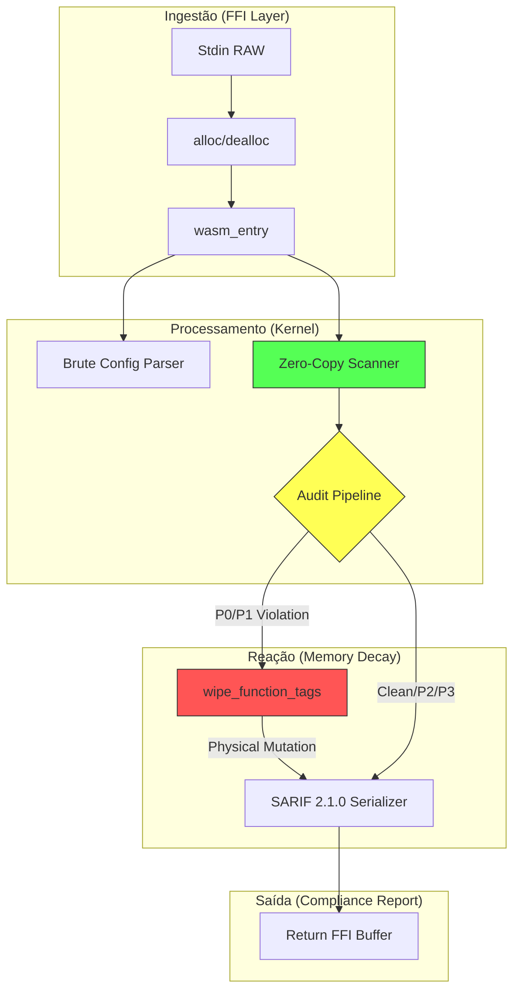
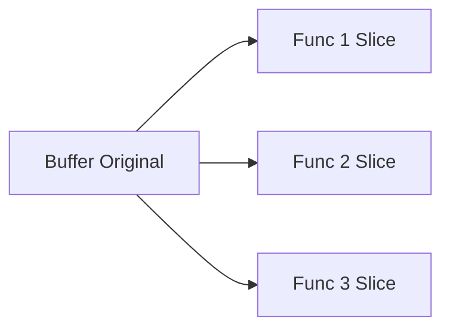

# Grafo de Lógica de Governância: ac_ant_delirium

> [!IMPORTANT]
> Esta especificação define o comportamento síncrono e mutável da governança de geodes L0. O motor segue o paradigma de **Análise Estática Zero-Copy**.

## 1. Visão Geral do Pipeline (Grafo Global)

A governança do Ant Delirium segue o paradigma de **Lei por Definição (Opt-in)**. Nenhuma regra é imposta por "hardcode" se não estiver explicitamente declarada no seu arquivo de configuração (`.toml`). Se uma regra for omitida ou zerada, ela é desativada por completo e o motor a ignora, dando liberdade total ao desenvolvedor para escolher quais restrições aplicar.



---

## 2. Detalhamento de Fases (Exploração Logística)

````carousel
### Fase 1: Ingestão de Contexto
O Host injeta o código fonte e as configurações via ponteiros FFI no heap da instância WASM. O `alloc` garante que o buffer seja preservado durante a execução.

```rust
// Interface Crítica
pub extern "C" fn audit_wasm_entry(...) -> *mut u8
```
<!-- slide -->
### Fase 2: Análise Zero-Copy
O `CodeScanner` não cria cópias de strings; ele opera sobre fatias (`&str`) do buffer original usando lifetimes, garantindo latência próxima de zero.


<!-- slide -->
### Fase 3: Gatilho de Memory Decay
O motor detecta falhas estruturais (ex: Nested level > 3) e aciona o `Wiper`.

> [!WARNING]
> O Wiper executa uma mutação física no buffer de código, apagando justificativas [WHY] obsoletas de funções não-conformes.
````

---

## 3. Matriz de Decisão de Regras

| Módulo | Nível | Foco Principal | Consequência de Falha |
| :--- | :--- | :--- | :--- |
| `tokens` | **P0** | Segurança (Poison Tokens) | Bloqueio Imediato |
| `deps` | **P0** | Purismo Externo (Whitelist) | Erro de Build |
| `layering` | **P0** | Arquitetura DAG (L0->L6) | Erro de Camada |
| `structure` | **P1** | Linearidade (Else-Free) | Memory Decay |
| `nesting` | **P1** | Abismo Cognitivo (Depth) | Memory Decay |
| `macros` | **P1** | Isolamento de Lógica | Bloqueio Estrutural |
| `metrics` | **P1** | Densidade Lógica (34 stmts) | Refatoração Mandatória |
| `params` | **P1** | Acoplamento de Interface | Aviso de Design |
| `purity` | **P1** | Ativação de Features (Opt-in) | Erro de Sanitização |
| `quality` | **P2** | Densidade Pedagógica | Alerta Word Salad |
| `markdown` | **P3** | Saúde do Ecossistema | Aviso de Estagnação |

---

## 4. Matriz de Escapes (Bypass Control)

Para situações excepcionais de engenharia, o motor aceita tokens de escape que suspendem a governança localmente:

| Token | Escopo | Descrição |
| :--- | :--- | :--- |
| `// [REASON]` | `else` | Justifica o uso de um bloco `else` (mín. 10 caracteres). |
| `[Safety Required]` | `tokens`, `density` | Permite tokens proibidos ou excesso de densidade em seções críticas. |
| `[TEMP_ALLOWED]` | `tokens` | Bypass temporário para migrações ou debug emergencial. |

---

## 5. Detalhamento Algorítmico (Engenharia de Elite)

### Detecção de Word Salad (Ratio > 0.8)
O motor não apenas conta palavras. Ele decompõe o nome da função (ex: `fn init_geode_core`) e verifica se a descrição `[WHAT]` contém os mesmos tokens. Se mais de 80% do nome for repetido em uma frase curta (< 12 palavras), a regra é disparada como **Definição Circular**.

### Densidade Lógica (34 Statements)
A complexidade no Ant Delirium é **Purely Logical**. Ignoramos o número de linhas físicas (comentários, espaços, quebras de linha) e focamos apenas nos **Statements Lógicos**. Contamos:
- Semicolons (`;`)
- Abertura de blocos condicionais (`{`)
- **Limite**: 34 statements por função.
- **Filosofia**: Você tem liberdade total de espaço, contanto que sua lógica permaneça atômica.

### P3: Archival Health (Saúde de Longo Prazo)
| Funcionalidade | Inovação | Como Testar | Expectativa |
| :--- | :--- | :--- | :--- |
| **MD Staleness** | Detecção de drift temporal (48h) entre código e doc. | Modifique o `.rs` e não toque no `.md` por 48h. | Documentação sempre síncrona. |
| **AI Manifest** | Exportação de símbolos e narrativas para JSON. | Ative `[manifest] enabled = true` no TOML. | Contexto estruturado para agentes IA. |

---

## 6. Manifesto Semântico para IA

Esta funcionalidade gera um arquivo `.manifest.json` para cada arquivo auditado. 

**Dados capturados:**
- **Símbolos**: Funções, Structs e Macros.
- **Narrativa**: O conteúdo das 4 tags governadas (`[WHAT]`, `[WHY]`, etc.) associado a cada símbolo.
- **Complexidade**: Métrica de densidade lógica para priorização de leitura pela IA.
- **Range**: Localização exata (linhas) para navegação cirúrgica.

**Uso Sugerido**: Ingestão por LLMs para construção de grafos de conhecimento do projeto sem parsing custoso da fonte bruta.
